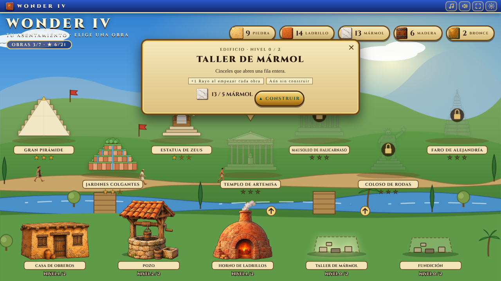

<div align="center">


# 🏛️ WONDER IV

**Puzle de combinar tres donde construyes las siete maravillas del mundo antiguo.**
Rompe el suelo bajo los bloques de material, mira cómo caen, cómo los obreros se los llevan y cómo tu asentamiento crece.

[](https://ivanchux.github.io/wonder-iv/)


</div>

---

## 📑 Índice

[Qué es](#-qué-es) · [Capturas](#-capturas) · [En movimiento](#-en-movimiento) · [Cómo se juega](#-cómo-se-juega) · [El asentamiento](#-el-asentamiento) · [Las maravillas](#-las-maravillas) · [Ejecutar y publicar](#-ejecutar-y-publicar) · [Detalles técnicos](#-detalles-técnicos) · [Estructura](#-estructura-del-repositorio) · [Licencia](#-licencia)

## 🏛️ Qué es

Wonder IV es un juego de navegador de combinar tres, ambientado en las obras de las siete maravillas del mundo antiguo. El tablero de 7 × 7 está lleno de piezas de piedra tallada y, entre ellas, de **bloques de material** (piedra, ladrillo, mármol, madera o bronce) que no se pueden mover. Para liberarlos hay que despejar lo que tienen debajo: caen por el tablero y, al llegar abajo, salen a la obra, donde **un obrero camina hasta el bloque, lo levanta en brazos y lo lleva al pie de la maravilla**.

- Funciona con **ratón y con pantalla táctil**: toca dos piezas contiguas o desliza una de ellas.
- **Sin librerías, sin instalación y sin paso de compilación**: HTML, CSS y JavaScript planos.
- **Un asentamiento propio** que mejoras con los materiales que recoges.
- El **récord, las estrellas, los materiales y los edificios** se guardan en el navegador.
- **Música y sonidos propios**, generados en el navegador: una pista para el pueblo y otra distinta para cada maravilla.
- Reacciones y efectos: chispas, ondas, confeti, mensajes de combo y obreros que celebran.
- Sin peticiones a terceros: tipografía, imágenes, sprites y sonido van con el juego.

## 📸 Capturas

<div align="center">

| Tu asentamiento | Mejorar un edificio |
|:---:|:---:|
|  |  |


 &nbsp; 

*En el móvil el mapa del asentamiento se desliza hacia los lados y el tablero ocupa todo el ancho.*

</div>

## 🎬 En movimiento

<div align="center">

**En el PC:** el bloque queda libre, cae y los obreros lo recogen para el montón de la obra


**En el móvil**


</div>

## 🎮 Cómo se juega

- Tablero de 7 × 7 con **siete piezas**: sol, anj, escarabajo, loto, laurel, ojo de Horus y ánfora, cada una con su color.
- Intercambia dos piezas contiguas para alinear tres o más del mismo tipo.
- **Los bloques de material no se mueven ni se combinan.** Cuando se despeja el suelo bajo ellos, bajan; al llegar a las dos filas de abajo salen del tablero y los obreros los llevan a la obra. Algunos valen dos bloques (lo indica un «×2»).
- **Se gana** cuando todos los bloques del tablero han salido y han llegado a la obra. **Se pierde** si se acaban los movimientos (aun así te quedas con la mitad de lo que habías entregado).
- **Piezas especiales.**
  - Alinear 4 crea el **sello alado**: limpia su fila y su columna.
  - Alinear 5 o más crea el **sol radiante**: limpia un cuadrado de 3 × 3.
  - Intercambiar dos especiales provoca una explosión combinada.
- **Poderes** de uso limitado por nivel: BOMBA, RAYO, REVOLVER (reorganiza el tablero sin tocar los bloques) y AURORA (quita todas las piezas de un tipo).
- **Sugerir** marca la jugada que despeja más suelo bajo un bloque.
- **Estrellas** según los movimientos que sobran: tres con el 40 % o más, dos con el 15 % o más, una en el resto.

## 🔊 Sonido, música y ajustes

Todo el sonido se **sintetiza con Web Audio en el navegador**: no hay archivos de audio ni peticiones externas.

- **Música generativa.** Ocho pistas con carácter propio: una tranquila para el pueblo y una por maravilla, cada una con su escala (frigia dominante en la Pirámide, hijaz en los Jardines, dórica en Zeus, mixolidia en Artemisa, eolia en el Mausoleo, jónica en el Coloso y lidia en el Faro), su tempo y sus instrumentos (flauta, arpa, pads, tambor de marco, timbales). La melodía se inventa compás a compás, así que nunca suena exactamente igual.
- **Efectos:** intercambio, trío (con notas que suben con el combo), piezas especiales, bloques que caen y salen, obreros que cogen y colocan, poderes, victoria, derrota y mejora de edificios.
- **Ajustes** (⚙ o `Esc`): volumen y silencio de música y efectos por separado, «reducir movimiento», ayuda y borrar progreso. También respeta `prefers-reduced-motion`.
- **Atajos:** `M` música · `F` pantalla completa · `H` pista · `Esc` ajustes.
- El sonido empieza con el primer toque (los navegadores no permiten audio antes) y se pausa al cambiar de pestaña.

## 🏘️ El asentamiento

El menú es tu pueblo. Las maravillas se levantan en el mapa según las completas (la siguiente aparece marcada con una flecha) y los materiales que entregan los obreros se guardan en el almacén de arriba. Con ellos mejoras cinco edificios básicos, cada uno con dos niveles; sus ventajas se aplican **al empezar cada obra**:

| Edificio | Material | Coste (nivel 1 / 2) | Ventaja por nivel |
|---|---|---|---|
| Casa de obreros | madera | 5 / 12 | +2 movimientos |
| Pozo | piedra | 5 / 12 | +1 Revolver |
| Horno de ladrillos | ladrillo | 5 / 12 | +1 Bomba |
| Taller de mármol | mármol | 5 / 12 | +1 Rayo |
| Fundición | bronce | 5 / 12 | +1 Aurora |

Rejugar una maravilla da más materiales. Es una primera versión del equilibrio: los costes y las ventajas se editan en `BUILDINGS` de `js/data.js`.

### 🏛️ Las maravillas

| # | Maravilla | Lugar | Época | Dificultad | Material | Bloques en el tablero | Para construirla | Movimientos |
|---|---|---|---|---|---|---|---|---|
| 1 | Gran Pirámide | Guiza, Egipto | c. 2560 a. C. | Fácil | piedra | 8 | 8 | 40 |
| 2 | Jardines Colgantes | Babilonia | c. 600 a. C. | Fácil | ladrillo | 9 | 9 | 40 |
| 3 | Estatua de Zeus | Olimpia, Grecia | c. 435 a. C. | Media | mármol | 8 | 10 | 44 |
| 4 | Templo de Artemisa | Éfeso | c. 550 a. C. | Media | madera | 8 | 11 | 52 |
| 5 | Mausoleo de Halicarnaso | Halicarnaso | c. 350 a. C. | Difícil | mármol | 8 | 12 | 44 |
| 6 | Coloso de Rodas | Rodas | c. 280 a. C. | Difícil | bronce | 8 | 13 | 50 |
| 7 | Faro de Alejandría | Alejandría, Egipto | c. 280 a. C. | Experta | piedra | 8 | 14 | 60 |

Las maravillas se desbloquean en orden: hay que completar la anterior para abrir la siguiente.

## 🚀 Ejecutar y publicar

### Jugar en local

No hace falta instalar nada. Abre `index.html` en el navegador, o sirve la carpeta:

```bash
git clone https://github.com/Ivanchux/wonder-iv.git
cd wonder-iv
python3 -m http.server 8000   # http://localhost:8000
```

### Publicar en GitHub Pages

1. Sube el repositorio a GitHub.
2. Ve a **Settings → Pages**.
3. En *Build and deployment* elige **Deploy from a branch**, rama `main` y carpeta `/ (root)`.
4. En un minuto estará en `https://ivanchux.github.io/wonder-iv/`.

## 🔧 Detalles técnicos

- **HTML, CSS y JavaScript planos.** Los scripts son clásicos (no módulos), se cargan en orden y comparten el ámbito global.
- **Arte:** piezas, bloques, marco, columnas, fondos de las siete obras y operarios son ilustraciones en `img/`; los edificios del asentamiento (niveles 1 y 2) son ilustraciones en `img/edificios/`; el mapa, los solares vacíos y las siete maravillas se dibujan en SVG desde el código (`js/asentamiento.js`, `js/maravillas.js`). Más detalles en [`docs/ARTE.md`](docs/ARTE.md).
- **Operarios** animados con hojas de 8 fotogramas (`img/obreros/`) y `steps()` de CSS; con `prefers-reduced-motion` se quedan quietos y las entregas son instantáneas.
- **Entrada unificada** con *pointer events*: toque sobre dos piezas contiguas o deslizamiento, válidos para ratón, táctil y lápiz.
- **Guardado** en `localStorage` dentro de `try/catch`: récord y estrellas (`wonder_best_*`, `wonder_stars_*`), materiales (`wonder_stock`), edificios (`wonder_build`), sonido (`wonder_audio`) y ajustes (`wonder_reduce`, `wonder_tuto`).
- **Efectos:** partículas en un canvas único (`js/efectos.js`) que solo se anima mientras hay algo que dibujar.
- **Las tareas pendientes de una obra se descartan** al cambiar de nivel o reiniciar, para que una entrega o un aviso de victoria antiguos no caigan sobre la partida nueva.
- **Tipografía:** Cinzel, incluida en `css/fonts/` (licencia SIL OFL 1.1, ver `css/fonts/OFL.txt`).
- **Pruebas:** `node tools/prueba/jugar.mjs` (necesita Playwright) comprueba el asentamiento, las ventajas, el guardado, que cada pista y cada efecto de sonido suenan sin saturar, los ajustes, los poderes y que un bot completa los siete niveles.
- **Regenerar el arte:** `tools/build-sprites.py` y `tools/build-art.py` convierten las hojas sobre fondo verde en PNG con transparencia, y `tools/build-icons.py` rehace el icono y los favicons (necesitan Python con Pillow y NumPy).
- No se puede jugar solo con teclado (los atajos son para música, pantalla completa, pista y ajustes).

## 📁 Estructura del repositorio

```text
wonder-iv/
├── index.html          # Marcado de las pantallas (asentamiento, partida, pantalla final)
├── css/
│   ├── wonder.css      # Estilos base
│   ├── antiguo.css     # Tema de maravillas antiguas
│   ├── nivel.css       # Pantalla de partida: fondo, tablero, marcadores, obreros
│   ├── asentamiento.css# Menú: mapa, almacén y panel de edificios, animaciones del pueblo
│   ├── interfaz.css    # Barra superior, ajustes, mensajes, globitos y efectos
│   └── fonts/          # Cinzel (OFL)
├── js/
│   ├── data.js         # Piezas, materiales, edificios y las siete maravillas  ← los niveles se editan aquí
│   ├── maravillas.js   # Las maravillas en SVG y el montón de bloques entregados
│   ├── asentamiento.js # Mapa del asentamiento, edificios en SVG y panel de mejoras
│   ├── audio.js        # Efectos y música generados con Web Audio
│   ├── efectos.js      # Partículas, ondas, confeti, mensajes de combo y reacciones de los obreros
│   ├── interfaz.js     # Barra superior, ajustes, ayuda, atajos y aviso de inicio de obra
│   ├── storage.js      # Récords, estrellas, materiales y edificios en localStorage
│   ├── state.js        # Estado global de la partida
│   ├── screens.js      # Cambio de pantalla
│   ├── rocas.js        # Bloques del tablero, salida y obreros
│   ├── engine.js       # Tablero, entrada, combinaciones, gemas, gravedad y pistas
│   ├── powerups.js     # Poderes
│   ├── hud.js          # Marcadores, pantalla final y registro
│   ├── sprites.js      # (generado) medidas de las hojas de operarios
│   ├── arte.js         # (generado) medidas del marco del tablero
│   └── main.js         # Arranque y botón de modo claro/oscuro
├── img/                # piezas, bloques, edificios, marco, columna, fondos y obreros
├── tools/              # prueba/jugar.mjs, build-sprites.py, build-art.py, build-icons.py
├── docs/               # Banner, capturas, GIFs, ARTE.md y los prompts de las imágenes
├── CHANGELOG.md
├── LICENSE             # PolyForm Noncommercial 1.0.0
└── README.md
```

## 🗺️ Ideas futuras

- [ ] Jugar solo con teclado
- [ ] Más pistas de música y una voz de cantero para las reacciones
- [ ] Ilustración propia para el mapa del asentamiento, el solar vacío y el título (los prompts están en `docs/PROMPTS_ASENTAMIENTO.md`)
- [ ] Equilibrar movimientos y costes con partidas de personas reales
- [ ] Textos en inglés

## 📜 Licencia

El código y el arte están bajo **[PolyForm Noncommercial 1.0.0](LICENSE)**.

**Puedes, sin pedir permiso:**
- Jugarlo y compartir el enlace.
- Estudiar el código y modificarlo para uso personal, educativo o sin ánimo de lucro.
- Subirlo a otra web o a tu propio hosting, siempre gratis y sin anuncios, conservando el aviso de copyright y la licencia.
- Hacer streams, vídeos y capturas del juego, aunque tu canal esté monetizado.

**Necesitas mi permiso por escrito para:**
- Vender el juego, una copia o una versión modificada.
- Publicarlo en tiendas de aplicaciones o plataformas de juegos.
- Incluirlo en una web con anuncios, suscripciones o compras.

---

<div align="center">

Hecho con 🔷 por **[Ivanchux](https://github.com/Ivanchux)**

⭐ Si te ha gustado, deja una estrella al repositorio.

</div>
