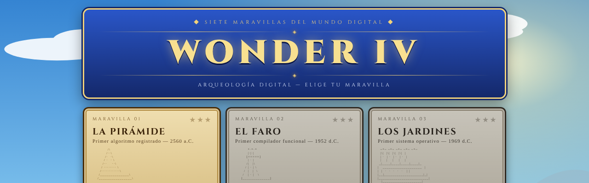
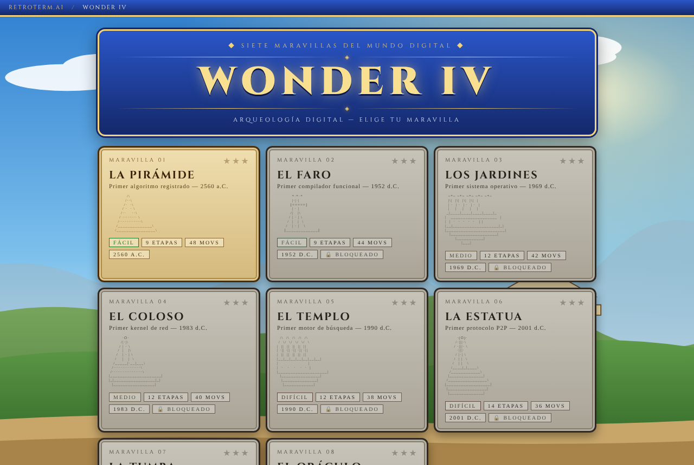
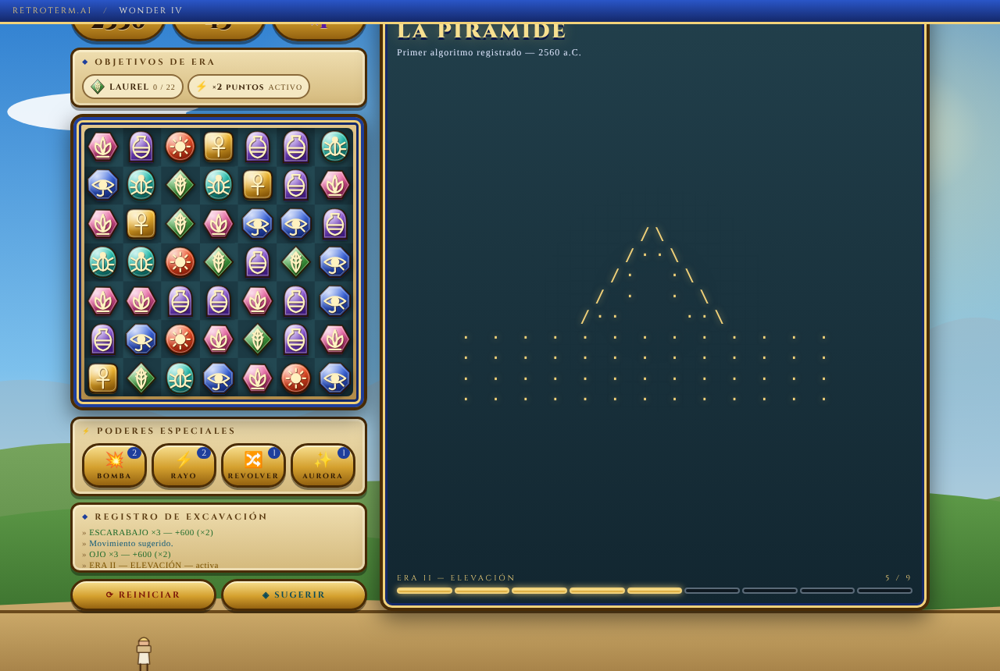
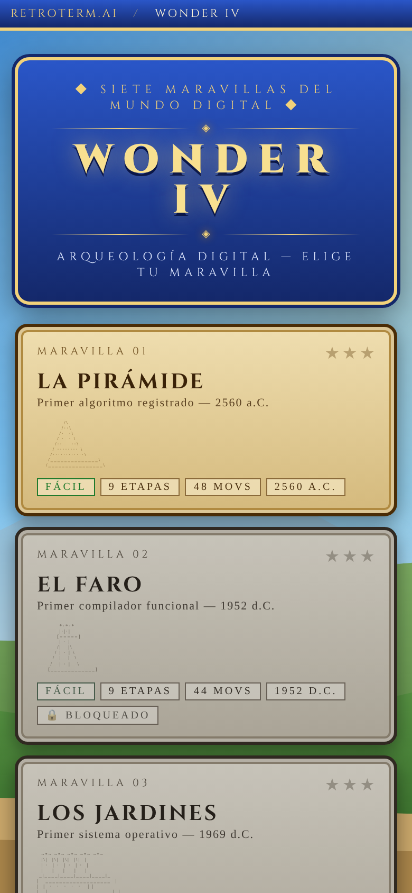
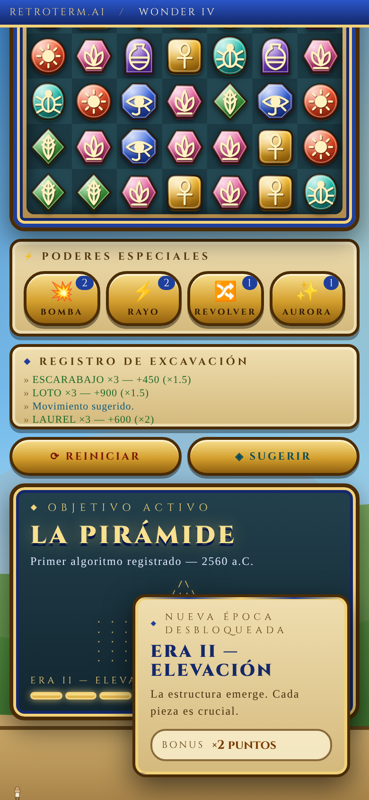
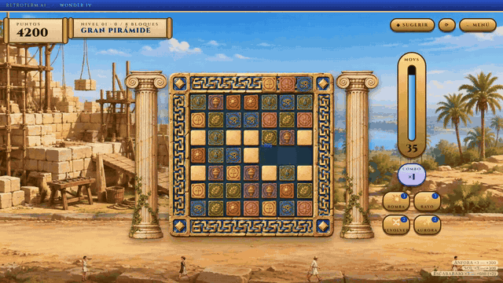
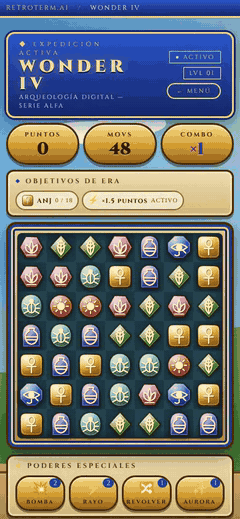

<div align="center">



# 🔷 WONDER IV

**Puzle de combinar tres con estética de terminal arqueológica.**
Cada nivel es una maravilla que se reconstruye pieza a pieza mientras su arte ASCII aparece línea a línea.

[](https://ivanchux.github.io/wonder-iv/)


</div>

---

## 📑 Índice

[Qué es](#-qué-es) · [Capturas](#-capturas) · [En movimiento](#-en-movimiento) · [Cómo se juega](#-cómo-se-juega) · [Las maravillas](#-las-maravillas) · [Ejecutar y publicar](#-ejecutar-y-publicar) · [Detalles técnicos](#-detalles-técnicos) · [Estructura](#-estructura-del-repositorio) · [Licencia](#-licencia)

## 🔷 Qué es

Wonder IV es un juego de navegador de puzles de combinar tres, con aspecto de maravillas del mundo antiguo: piezas de piedra tallada (sol, anj, escarabajo, loto, laurel, ojo y ánfora, cada una con su color y su silueta), tablero con marco de lapislázuli y oro, marcadores de pergamino y un paisaje de cielo, colinas y columnas. El tablero es de 7 × 7 con siete tipos de ficha y cada combinación hace avanzar la reconstrucción de una maravilla, dibujada en arte ASCII que aparece línea a línea. Hay **8 maravillas**, cada una dividida en **3 eras**.

- Funciona con **ratón y con pantalla táctil**: toca dos fichas contiguas o desliza una de ellas.
- **Sin librerías, sin instalación y sin paso de compilación**: HTML, CSS y JavaScript planos.
- El **récord y las estrellas** de cada maravilla se guardan en el navegador.
- Modo claro y oscuro con el botón de la barra superior.
- Nació dentro de [RETROTERM.AI](https://ivanchux.github.io/Retroterm-AI/) y ahora vive en su propio repositorio para poder crecer.

## 📸 Capturas

<div align="center">

| Menú de maravillas | Partida |
|:---:|:---:|
|  |  |

 &nbsp; 

*En el móvil el tablero ocupa todo el ancho y las fichas se mueven con un toque o deslizando el dedo.*

</div>

## 🎬 En movimiento

<div align="center">

**En el PC:** combinaciones, puntuación flotante y la pirámide apareciendo línea a línea



**En el móvil**



</div>

## 🎮 Cómo se juega

- Tablero de 7 × 7 con siete tipos de ficha: DELTA, LAMBDA, ORBIT, HEX, TARGET, NODE y CORE.
- Intercambia dos fichas contiguas para alinear tres o más del mismo tipo.
- Cada combinación hace avanzar la reconstrucción de la maravilla. Al completar
  todas sus etapas antes de quedarte sin movimientos, ganas el nivel.
- **Eras.** Cada maravilla se divide en tres eras. Cada era pide recoger una
  cantidad de un tipo de ficha concreto y multiplica la puntuación (de ×1,5 a ×5).
- **Gemas especiales.**
  - Alinear 4 crea una **gema de línea**: al usarla limpia su fila y su columna.
  - Alinear 5 o más crea una **gema de área**: limpia un cuadrado de 3 × 3.
  - Intercambiar dos gemas entre sí provoca una explosión combinada.
- **Poderes**, de uso limitado por nivel: BOMBA, RAYO, REVOLVER (baraja el tablero) y AURORA.
- **Estrellas.** Se ganan según los movimientos que sobran al terminar:
  tres estrellas con el 40 % o más, dos con el 15 % o más, una en el resto.
- El récord y las estrellas de cada maravilla se guardan en el navegador.

### 🏛️ Las maravillas

| # | Maravilla | Época | Dificultad | Etapas | Movimientos |
|---|---|---|---|---|---|
| 1 | La Pirámide | 2560 a. C. | Fácil | 9 | 48 |
| 2 | El Faro | 1952 | Fácil | 9 | 44 |
| 3 | Los Jardines | 1969 | Media | 12 | 42 |
| 4 | El Coloso | 1983 | Media | 12 | 40 |
| 5 | El Templo | 1990 | Difícil | 12 | 38 |
| 6 | La Estatua | 2001 | Difícil | 14 | 36 |
| 7 | La Tumba | 2012 | Experta | 15 | 32 |
| 8 | El Oráculo | 2045 | Experta | 15 | 28 |

## 🚀 Ejecutar y publicar

### Jugar en local

No hace falta instalar nada. Abre `index.html` en el navegador.

```bash
git clone https://github.com/Ivanchux/wonder-iv.git
cd wonder-iv
# abre index.html, o sirve la carpeta si prefieres:
python3 -m http.server 8000   # http://localhost:8000
```

### Publicar en GitHub Pages

1. Sube el repositorio a GitHub.
2. Ve a **Settings → Pages**.
3. En *Build and deployment* elige **Deploy from a branch**, rama `main` y carpeta `/ (root)`.
4. En un minuto estará en `https://ivanchux.github.io/wonder-iv/`.

Al estar en el mismo dominio que RETROTERM.AI, el récord y las estrellas guardados desde el hub se conservan.

## 🔧 Detalles técnicos

- **HTML, CSS y JavaScript planos.** Los scripts son clásicos (no módulos), se cargan en orden y comparten el ámbito global.
- **Fichas y gemas en SVG** generadas desde `js/data.js`, donde también se editan los niveles.
- **Entrada unificada** con *pointer events*: toque sobre dos fichas contiguas o deslizamiento, válidos para ratón, táctil y lápiz.
- **Fondo de partículas** y arte ASCII animado en canvas y DOM.
- **Guardado** del récord y las estrellas en `localStorage`, dentro de `try/catch`.
- **Pruebas:** `tools/bot` ejecuta el código real del motor en Node con un DOM simulado, reloj virtual y semilla fija.
- **Tipografía:** Cinzel, incluida en `css/fonts/` (licencia SIL OFL 1.1, ver `css/fonts/OFL.txt`). Ya no hay peticiones a terceros.
- **Aspecto:** `css/antiguo.css` se carga después de `css/wonder.css` y solo cambia el aspecto; las piezas y el paisaje son SVG propios (`js/data.js` e `index.html`).
- No tiene sonido ni controles de teclado.

## 📁 Estructura del repositorio

```text
wonder-iv/
├── index.html        # Marcado de las pantallas (menú, partida, avisos de era, pantalla final)
├── css/wonder.css    # Estilos base y maquetación
├── css/antiguo.css   # Tema de maravillas antiguas (colores, marcos, tipografía)
├── css/fonts/        # Cinzel (OFL)
├── js/
│   ├── data.js       # Fichas, gemas en SVG y las maravillas con sus eras  ← los niveles se editan aquí
│   ├── storage.js    # Récords y estrellas en localStorage
│   ├── state.js      # Estado global de la partida
│   ├── screens.js    # Cambio de pantalla y menú de selección
│   ├── fx.js         # Partículas, fondo de la escena y arte ASCII
│   ├── engine.js     # Tablero, entrada, intercambios, combinaciones, gemas, gravedad y pistas
│   ├── powerups.js   # Poderes especiales
│   ├── hud.js        # Marcadores, puntuación flotante, pantallas finales y registro
│   └── main.js       # Arranque y botón de modo claro/oscuro
├── tools/bot/        # Bot y arnés de pruebas en Node
├── docs/             # Banner, capturas y GIFs de este README
├── CHANGELOG.md      # Historial de versiones
├── LICENSE           # PolyForm Noncommercial 1.0.0
└── README.md
```

## 🗺️ Ideas futuras

- [ ] Sonido y silencio
- [ ] Controles de teclado
- [ ] Pausa al cambiar de pestaña
- [ ] Textos en inglés

## 📜 Licencia

El código y el arte están bajo **[PolyForm Noncommercial 1.0.0](LICENSE)**.

**Puedes, sin pedir permiso:**
- Jugarlo y compartir el enlace.
- Estudiar el código y modificarlo para uso personal, educativo o sin ánimo de lucro.
- Subirlo a otra web o a tu propio hosting, siempre gratis y sin anuncios, conservando el aviso de copyright y la licencia.
- Hacer streams, vídeos y capturas del juego, aunque tu canal esté monetizado.

**Necesitas mi permiso por escrito para:**
- Vender el juego, una copia o una versión modificada.
- Publicarlo en tiendas de aplicaciones o plataformas de juegos.
- Incluirlo en una web con anuncios, suscripciones o compras.

---

<div align="center">

Hecho con 🔷 por **[Ivanchux](https://github.com/Ivanchux)**

⭐ Si te ha gustado, deja una estrella al repositorio.

</div>
